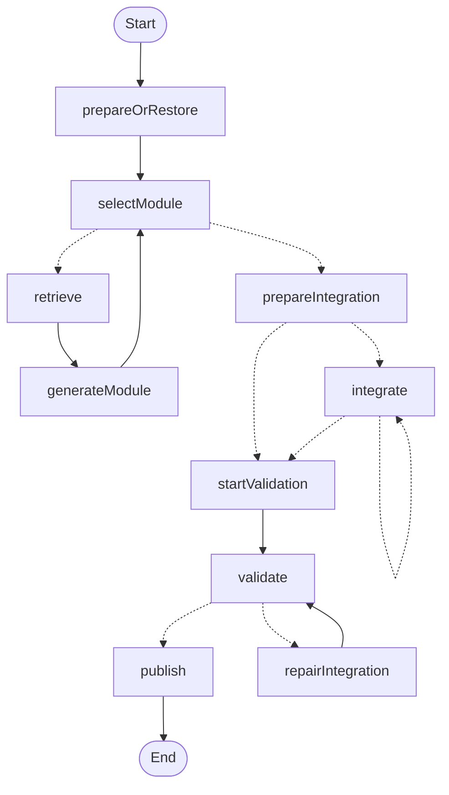

# 在 LangSmith Studio 查看当前 RECAST Graph

此入口直接调用生产 `createProjectPipelineGraph` 工厂，展示当前项目级状态图的真实结构。它不绑定 VS Code 项目、模型及工作目录，因此仅供结构查看；在 Studio 点击运行会明确提示从 RECAST 工作台启动真实任务。日常使用仍执行 `npm run dev:extension`。

## 启动与打开

在当前平台对应的仓库目录执行，Windows 和 WSL 命令相同：

```sh
npm run graph:studio
```

首次运行会通过 npm 缓存获取固定版本的官方 `@langchain/langgraph-cli@1.5.7`，不加入产品依赖。服务绑定 `127.0.0.1:2024`。在 LangSmith 中登录自己的账号后，打开：

[LangSmith Studio 本地 Graph](https://smith.langchain.com/studio?baseUrl=http://127.0.0.1:2024)

在 Graph 下拉框选择 **`recast_project_structure`**。图中可以查看节点、条件分支和循环，Start 为 `__start__`，End 为 `__end__`。

若账号或 Studio 提示需要 API key，在启动服务的本机终端设置 `LANGSMITH_API_KEY`，随后重新运行上述命令。它与 DeepSeek key 不同；无需将 key 发到聊天或写入 `langgraph.json`。如果服务已在运行，先在所属终端按 Ctrl+C 停止。

```powershell
# Windows PowerShell；将占位内容替换为本机 LangSmith key。
$env:LANGSMITH_API_KEY = '<本机 LangSmith key>'
npm run graph:studio
```

```sh
# WSL / Linux；在 Linux 工作区执行。
export LANGSMITH_API_KEY='<本机 LangSmith key>'
npm run graph:studio
```

配置中的 `LANGSMITH_TRACING=false`、`LANGCHAIN_TRACING_V2=false` 用于关闭 tracing。此结构入口没有业务模型调用，不会上报以往的运行记录或重新执行生成任务。开发服务器自身的运行数据目录 `.langgraph_api/` 已加入 Git 忽略列表。

## 当前实际结构

以下为 2026-11-03 从本地 Studio 服务的 Graph API 读取的节点和连线，共 10 个业务节点、Start / End、15 条边。实线为普通边，虚线为条件边；条件含义见下表。



| 节点 | 当前职责 |
| --- | --- |
| `prepareOrRestore` | 准备新项目，或恢复现有运行快照 |
| `selectModule` | 跳过已完成模块，选择下一个模块；模块处理完后转入集成 |
| `retrieve` | 检索历史候选 |
| `generateModule` | 调用现有生成能力，内部包含 Translator、编译、Verifier 与原有修复循环 |
| `prepareIntegration` | 整理项目集成任务；没有任务时直接进入验收 |
| `integrate` | 串行执行集成任务；仍有任务时继续本节点 |
| `startValidation` | 进入项目最终验收阶段 |
| `validate` | 最终验收；通过后提交，需修复时进入原有有限修复流程 |
| `repairIntegration` | 按原有预算执行集成修复，之后重新验收 |
| `publish` | 提交独立输出项目 |

这是外层项目 Graph。Verifier 的 LangChain Agent 在业务端口内部动态创建，**不是这张图里可直接展开的注册子图**；Host 反馈复核循环也未另行图化。这里不把它画成虚构的子节点，也没有新增并行 worker。错误、取消、持久化与清理仍由原 `ProjectPipeline` 宿主管理，不是新增的失败节点。

结构查看不等于正在执行的任务追踪。此入口没有把先前的真实模型运行导入 LangSmith；若后续需要查看生产任务的时间线，应另行接入实际运行的 tracing 上下文。

## 实现与已验证范围

- 配置：[`../langgraph.json`](../langgraph.json)
- 结构入口：[`../scripts/langsmith-project-graph.ts`](../scripts/langsmith-project-graph.ts)
- 实际生产工厂：[`../apps/vscode-extension/src/project-pipeline-graph.ts`](../apps/vscode-extension/src/project-pipeline-graph.ts)

已在 Windows 启动官方本地服务，`/info` 返回 HTTP 200，运行库为 `langgraph_js_version=1.5.2`。官方 JavaScript SDK 成功取得上述实际 Graph 数据。浏览器自动控制因无法可靠确认网址被停止，未完成 Studio 页面截图或声称页面可视化已经验收；请通过上述链接在本机账号中查看。

官方说明：[Studio 本地接入](https://docs.langchain.com/oss/javascript/langgraph/studio)、[CLI 配置](https://docs.langchain.com/langsmith/cli)。
