# RECAST 企业使用说明书

面向企业管理员、研发人员和验收人员，指导使用 VS Code 中的 RECAST 工作台完成目标工程导入、参考工程建模、需求输入、自动生成、失败恢复与结果交接。

**版本日期：2026 年 10 月 22 日。** 本说明按当前工作区实现编写，主流程为“整个项目”全自动模式，支持 Windows 原生与 WSL2。安装方式采用当前仓库提供的开发启动入口。

**截图说明：** 截图由当前版本的实际前端渲染，项目名称、路径、进度与验收状态使用脱敏演示数据；用于说明操作，不代表一次真实业务交付。圈号是说明书添加的操作标记。界面主题、项目数量及模型名称可随企业配置不同。

## 阅读路线

- 首次部署：阅读“使用前的准备”“Windows 安装与启动”或“WSL 安装与启动”，再配置 AI 服务。
- 日常操作：打开工作台 → 导入目标工程 → 按需导入参考工程 → 确认建模 → 输入需求 → 开始执行 → 查看项目与报告。
- 运行失败：先阅读错误与日志，再选择“继续任务”或“重试此模块”；需求变化时重新开始项目任务。
- 交付验收：同时检查项目结果、最终行为验证和验收报告，再进入企业自己的业务验收与发布流程。

**准备三类输入：** 可构建的目标骨架、明确的需求与验收条件、可选的历史代码仓库。整个项目模式将代码保存到独立输出项目；请通过工作台打开结果。

后文图示统一使用虚构的订单服务 OrderService；OrderLegacy 与 AuditLibrary 为参考工程示例。路径仅用于示意，请替换为本机路径。

<!-- page -->

## 01 使用前的准备

管理员先确定使用 Windows 原生或 WSL2。扩展、依赖、Codex CLI 和目标语言编译器应在同一平台运行。业务操作者在管理员完成准备后，可从“认识工作台”开始。

| 准备项 | 企业需要确认的内容 |
| --- | --- |
| 基础软件 | Node.js 24 LTS 与 npm、Git、VS Code、Docker Desktop，使用 Linux 容器 |
| 运行资源 | 建议至少 8 GB 可用内存；首次准备模型与镜像需要网络和足够磁盘空间 |
| 生成工具 | 同平台安装 Codex CLI；模型端点须支持项目流水线使用的 Responses API |
| 目标工具链 | C# 使用对应 .NET SDK；Java 使用工程要求的 JDK 与 Maven；其他语言按工程要求安装 |
| 输入工程 | 选择实际项目根目录，保留工程文件、接口、依赖声明和必要测试，先验证本平台可构建 |
| 服务权限 | 准备企业批准的模型账号、Key、地址及模型名，确认额度、网络和协议可用 |

**目标工程**是希望补全或改造的项目，可以是骨架；**参考工程**是用于检索已有实现的代码仓库，可以一次添加多个。参考工程可不提供。

首次上线前，由管理员确认代码可以发送到所配置的模型服务。联网模型调用可能包含需求、代码及执行上下文；本地索引和模型缓存不等于所有处理都离线。

Windows 与 WSL 各自维护源码目录、依赖、扩展构建和凭据。不要在 Windows 目录中执行 Linux 的依赖安装。需要同时维护两平台时，按仓库根目录 README 的同步说明操作。

<!-- page -->

## 02 Windows 安装与启动

1. 安装 Git、Node.js 24 LTS、VS Code 和 Docker Desktop。打开 Docker Desktop，完成初始化并使用 Linux 容器。按目标工程安装语言 SDK，例如 .NET 8。
2. 新开 PowerShell，确认 `node --version`、`git --version`、`code --version`、`docker info` 可运行，再获取 RECAST。

```powershell
git clone https://github.com/chiparon/weichai.git E:\work\recast
Set-Location E:\work\recast
npm run workspace:check
npm ci
npm run workspace:check
npm install --global @openai/codex
codex --version
```

第一次检查若仅提示缺少本平台依赖，执行 `npm ci` 后再次检查。若提示目录属于其他平台，应先改正工作目录。企业已有交付目录时，进入该目录执行相应步骤，无需再次克隆。

3. 首次指定索引数据库名称，之后保持一致；启动工作台。

```powershell
$env:CODE_INTELLIGENCE_SEEKDB_DATABASE = 'recast'
npm run dev:extension
```

4. 等待终端出现 **RECAST services ready**，并等待新开的扩展开发窗口就绪。首启会准备或复用 SeekDB、推理运行时和本地模型服务，再构建并打开扩展。
5. 后续每天在同一 RECAST 根目录执行 `npm run dev:extension`。若使用独立数据库或缓存配置，应保持这些启动配置一致。目标语言 SDK 和 RECAST 项目依赖需预先安装。

首次下载较慢时，可在启动前设置 `$env:RECAST_SERVICES_WAIT_MS = '900000'` 延长服务准备等待时间。该参数不控制项目翻译时长。

<!-- page -->

## 03 WSL 安装与启动

Windows 端安装 VS Code、WSL 扩展和 Docker Desktop。安装并初始化 Ubuntu 24.04，在 Docker Desktop 的 Settings → Resources → WSL integration 中启用该发行版。

1. 在 Ubuntu 中安装 Git、Python 3、构建基础工具和 Linux 版 Node.js 24。确认 `command -v node` 指向 Linux 路径，且 `docker info`、`code --version` 正常。详细安装命令见仓库根目录 README。
2. 将项目放到 Linux 文件系统中，以下命令全部在 Ubuntu 终端运行。

```bash
mkdir -p ~/src
git clone https://github.com/chiparon/weichai.git ~/src/recast
cd ~/src/recast
npm run workspace:check
npm ci
npm run workspace:check
mkdir -p ~/.local
npm install --global --prefix ~/.local @openai/codex
export PATH="$HOME/.local/bin:$PATH"
codex --version
```

3. 安装目标工程对应的 Linux SDK，设置数据库并启动。

```bash
export CODE_INTELLIGENCE_SEEKDB_DATABASE=recast
npm run dev:extension
```

4. 确认开发窗口显示 WSL 连接，扩展与编译器均在 Linux 中运行。导入的工程使用扩展宿主能够读取的 Linux 路径，例如 `/home/demo/projects/OrderService`。

将 CLI 的 PATH 配置持久保存到自己的 shell 配置。不要在 `/mnt/c`、`/mnt/e` 下的 Windows checkout 安装 Linux 依赖。Windows 与 WSL 首次应分别保存工作台的 AI 凭据。

<!-- page -->

## 04 认识工作台

在扩展开发窗口中，点击左侧 RECAST 图标，再点击“打开工作台”；也可打开命令面板，执行 **RECAST: 打开智能开发工作台**。建议将编辑器区域最大化。

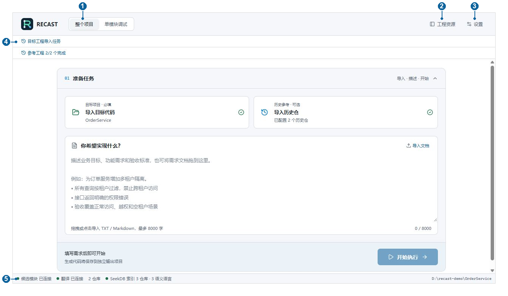

1. **整个项目**是本说明的主要入口，输入项目与需求后，由系统串联各阶段执行。
2. **工程资源**打开左侧导航；其中“目标工程”和“参考工程”用于切换、浏览工程与模块。
3. **设置**配置 AI 服务、候选方案数量和参考工程路径。修改后要点击“保存设置”。
4. 顶部的导入任务栏可展开查看导入情况；点任务面板右上角叉号只是收起，后台任务继续运行。
5. 底部显示候选模块服务、翻译服务和索引状态。绿色表示服务依赖就绪，不能证明 Key 授权成功或本次业务已经验收通过。

“单模块调试”供研发人员定位问题，可能回填当前目标工程；正式生成请优先使用“整个项目”的独立输出流程。

<!-- page -->

## 05 配置 AI 服务

点击右上角“设置”，找到“AI 服务”。下图展示字段位置，模型名仅为界面示例，实际以企业账号可用模型为准。

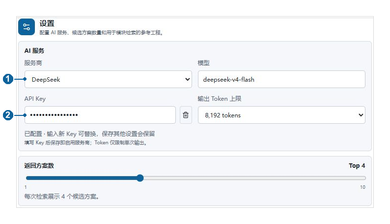

1. 选择**服务商**并填写**模型**。使用企业网关时，按管理员给出的配置填写自定义 API 地址。
2. 输入 API Key，点击右下角**保存设置**，或按 Ctrl+S。保存后应显示“已配置”；密码圆点不是明文 Key。
3. 保持现有 Key 时，修改其他设置不需要重复输入。更换服务商或 API 地址后，应确认对应凭据并重新保存。
4. **输出 Token 上限**限制单次输出量，不能用来延长翻译时间。**返回方案数**控制检索候选数量，初次使用可保留默认值。

Key 由 VS Code SecretStorage 保存，不应写入需求文档、参考仓库或版本库。仅在终端设置某个模型 Key，不等于完成了工作台凭据配置。

企业管理员应先验证端点、模型与额度。项目流水线通过 Codex CLI 使用 Responses API；只支持 Chat Completions 的兼容代理不能直接代用。设置列表提供配置入口，不保证每个供应商的任意端点都能完成整个项目流水线。

<!-- page -->

## 06 导入目标工程

在“准备任务”中点击**导入目标代码**，选择本地项目根目录。若从“工程资源”的项目选择器操作，也可使用“添加目标工程…”或“输入项目路径…”入口。多项目仓库需确认具体项目选择正确。

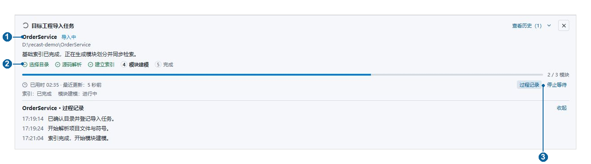

1. 选择目录后，顶部出现独立的**目标工程导入任务**。核对工程名称和路径。
2. 按阶段查看进展：**选择目录 → 源码解析 → 建立索引 → 模块建模 → 完成**。进度条和文件或模块计数表示当前阶段，不能据此推算整个任务剩余时间。
3. 点击**过程记录**查看详细反馈；点击**查看历史**查看以前的导入及失败记录。面板同时显示耗时和最近更新时间。
4. 以“索引：已完成”和“模块建模：已完成”确认导入结果，再到“工程资源”检查模块。目录已登记或只显示文件列表，不等于模块建模完成。

点叉号后，可点顶部“目标工程导入任务”再次展开。失败或中断时，先检查错误，再点**重试导入**。解析阶段可能提供“取消导入”；建模阶段显示的“停止等待”不应理解为保证立即终止底层建模。

<!-- page -->

## 07 添加多个参考工程

参考工程用于复用已有实现，可按需提供。点击“导入历史仓”进入配置，或直接打开“设置”，向下找到**参考工程路径**。

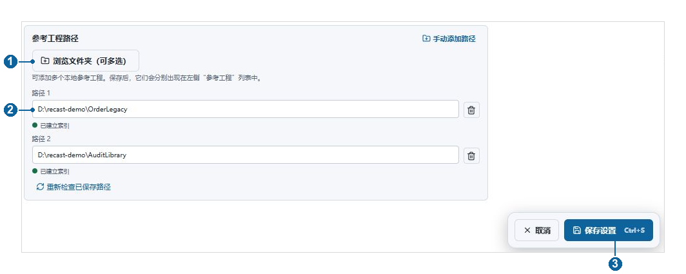

1. 点击**浏览文件夹（可多选）**，选择需要参考的本地代码仓库。也可点**手动添加路径**逐项填写。
2. 每项填写仓库根目录，一次最多配置 20 条路径。确认路径存在且当前运行平台可读取；不要仅填写远端 Git URL。
3. 点击**保存设置**。保存后的工程会进入参考工程列表与导入流程，多个工程按队列串行处理。
4. 已有路径报错时，可点击**重新检查已保存路径**检查可访问性，再查看具体导入任务。路径可读不等于索引和建模已完成。

图中 OrderLegacy 和 AuditLibrary 代表两份独立参考代码。选择与目标业务、语言或设计接近的仓库，有助于获得更相关的实现参考；添加大量无关代码不会自动提高结果质量。

路径右侧删除按钮用于修改配置，点击后需保存。移除引用不等于删除本地代码文件；操作前应确认后续任务是否仍需使用该参考工程。

<!-- page -->

## 08 跟踪参考工程导入

参考工程与目标工程采用相同的任务展示方式。用户不需要反复点击导入来确认是否在工作。

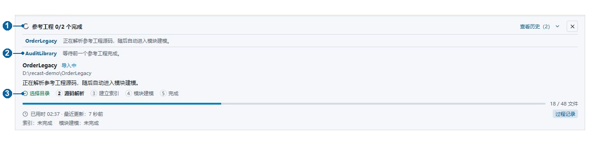

1. 展开顶部**参考工程导入任务**，先看“已完成数 / 总数”，再查看各仓库当前状态。
2. 正在处理的工程会显示解析、索引或建模进度；其他工程显示等待。等待中的工程不需要重复提交。
3. 点击仓库名称或**查看历史**，定位该工程的过程记录。出现失败时，先处理路径、模型或工具链问题，再使用**重试**或**重试导入**。
4. 确认所需参考工程的索引与模块建模均完成，再开始依赖这些参考工程的生成任务。“已配置多个历史仓”只是配置数量，不代表全部可用于检索。

收起面板不停止导入。长时间没有更新时，先查看最后一条过程记录及“输出 → RECAST”的错误信息；不要通过重复添加相同路径来催动任务。

<!-- page -->

## 09 检查工程和模块建模结果

点击右上角**工程资源**。在左侧选择“目标工程”或“参考工程”，用工程选择器切换仓库及具体项目。

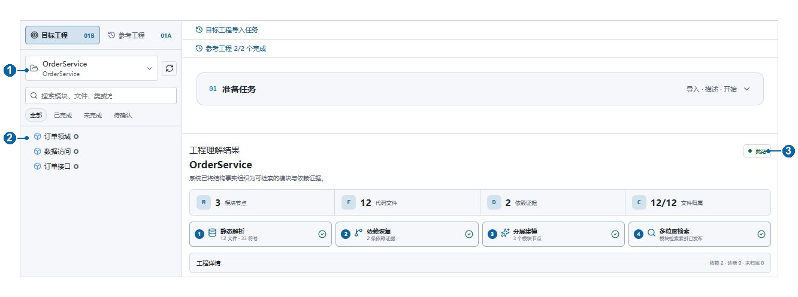

1. 在模块树中检查业务模块、关联文件与实现状态，可搜索模块、文件或成员，并使用“全部 / 已完成 / 未完成 / 待确认”筛选。
2. 收起“准备任务”或向下滚动，浏览工程理解区域，检查模块节点、代码文件、依赖证据和文件归属。展开**工程详情**查看诊断、未归属项和建模提示。
3. 若仍为文件视图，查看建模状态和错误。界面提供时，点击**开始模块建模**；失败时点击**重试建模 / 同步**；建模完成但检索未就绪时使用**同步检索**。
4. 源码修改后应刷新该仓库并检查最新索引与建模结果，避免将历史版本的结果当作当前代码。

模块树中的实现状态描述输入工程的分析结果；它与本次生成任务的最终行为验收是两个层面的信息。不要仅凭树中“已完成”判断新项目已经验收。

<!-- page -->

## 10 输入需求并开始执行

回到**整个项目**，确认目标项目正确、所需导入已完成，在“你希望实现什么？”中填写本次任务。

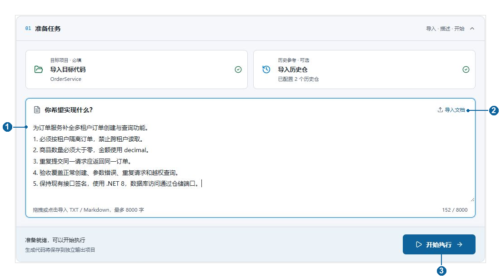

1. 直接粘贴正文，或点击**导入文档**，也可把一个文档拖入输入区。支持 UTF-8 TXT 与 Markdown，文件不超过 256 KiB，正文最多 8000 字符；不直接支持 DOCX 或 PDF。
2. 需求应明确业务目标、接口约束、异常场景和验收条件。例如说明租户隔离、重复请求、金额规则，以及禁止改动的接口。
3. 检查正文与字符计数。文件名不是需求本身，系统使用输入区中的正文执行。
4. 点击**开始执行**一次，等待宿主确认。开始后可在“本次需求与输入材料”查看本次配置。

按钮不可用时，检查是否已选择目标项目、需求是否为空、是否仍在导入或已有任务运行。若提示宿主尚未确认，先刷新状态，避免重复启动。

完整需求范例见同目录 `examples/订单服务需求示例.md`。它用于说明写法，需按实际骨架、业务接口和测试环境调整。

<!-- page -->

## 11 查看执行进度和日志

点击开始后，系统会自动推进工作流。通常无需逐阶段手工批准；出现错误或需要补充配置时，再按提示处理。

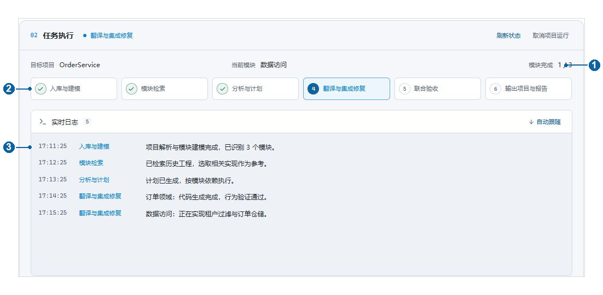

1. 查看**任务执行**中的目标项目、当前模块、模块完成数。完成数不包含所有验证和交付工作，不能作为剩余时间估计。
2. 阶段依次展示**入库与建模、模块检索、分析与计划、翻译与集成修复、联合验收、输出项目与报告**。
3. 在**实时日志**观察正在处理的内容。向上滚动可阅读旧记录；点击**跟随最新**回到最新日志。
4. 状态看起来未更新时，点击**刷新状态**读取宿主状态。该按钮不会重新创建任务。
5. 需要主动停止时，点击**取消项目运行**，等待状态转为停止；再根据断点情况决定继续或重新开始。

刷新界面与关闭扩展窗口含义不同。扩展窗口或启动进程关闭可能中断执行；重开后应先检查运行状态与断点，不要直接再次点击开始。生成期间请保持运行环境、模型配置及输出副本稳定。

<!-- page -->

## 12 失败或中断后继续任务

当任务显示“执行失败”“已取消”或“执行已中断”，先读取错误，修复原因，再选择恢复方式。

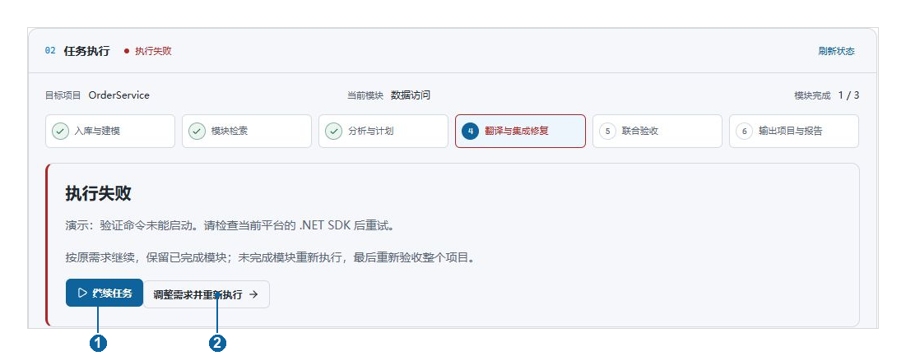

1. **继续任务**：沿用原需求和运行编号，保留可复用的已完成模块，重新执行未完成部分，最后再次验收整个项目。
2. **调整需求并重新执行**：展开本次配置，修改需求后点击**重新开始项目任务**，创建新的项目运行。适用于业务范围、约束或输入发生变化。
3. 要先定位问题，可查看执行副本、实时日志和验收报告；保留运行编号，便于追踪。

“继续任务”只在系统已有可恢复的执行副本、基线和模块记录时出现。若准备阶段就失败，尚未形成可用断点，应修复原因后重新开始。

不要直接修改工作台管理的执行副本后再尝试无条件续跑。若原骨架、参考版本或任务配置已变化，应先确认变化是否影响原断点；需要改变需求或输入时使用新任务。

<!-- page -->

## 13 单个模块失败后重试

任务停止后，向下展开**模块执行明细**，定位失败模块及其验证信息。

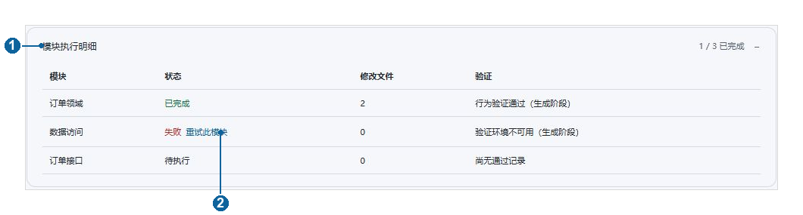

1. 先查看“验证”列，确认属于代码缺陷、验证环境不可用还是行为结论未确定。按实际错误修复 SDK、依赖、命令或配置。
2. 在对应模块状态旁点击**重试此模块**。此入口仅在可恢复并满足重试条件时显示，运行中的任务需先停止。
3. 系统从指定模块重新执行，并按依赖关系处理受影响的下游模块及集成任务；与该模块无关且可复用的已完成部分会保留。
4. 重试完成后仍须等待项目联合验收，不能只看该模块从红色转为已完成。

图中的“行为验证通过（生成阶段）”属于中间记录。“验证环境不可用（生成阶段）”说明当时无法完成有效验证，不能直接断言生产代码有错或正确。先修环境，再重新验证。

仅想调整一个模块但同时改变了整体需求时，应创建新任务，避免将新需求和旧断点混用。

<!-- page -->

## 14 打开输出项目并导出报告

项目任务结束后，查看交付结果区域。生成阶段与最终验收是独立步骤；请连同报告中的验证范围一起检查。

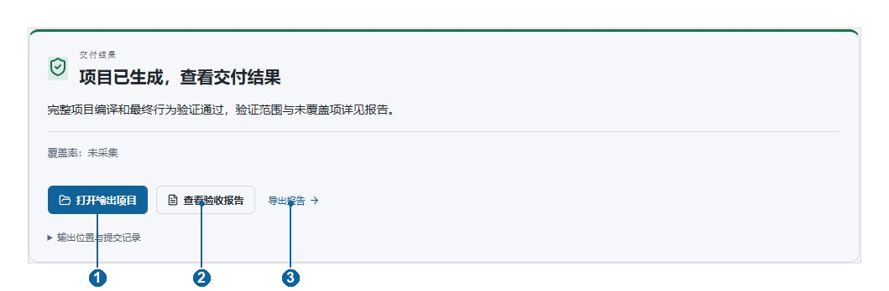

1. 点击**打开输出项目**，打开生成后的独立工程。尚未完成时，入口显示为**查看执行副本**。
2. 点击**查看验收报告**，检查需求追溯、模块证据、构建与验证情况、未覆盖项和失败原因。
3. 点击**导出报告**，按提示保存到企业交付目录。报告导出与项目代码交付是不同操作。
4. 展开**输出位置与提交记录**，核对输出路径和提交；展开**运行编号**保存本次任务标识。

项目由工作台保存在本平台 VS Code 存储中的任务目录，路径随用户和运行变化。通过按钮定位输出，不要套用示例用户的绝对路径。交付时将输出代码和报告归档到企业管理的位置。

整个项目流程不直接覆盖原始骨架；输出项目的提交记录用于追溯本次生成，不代表已经推送企业仓库、合并分支或部署生产环境。这些操作按企业正常流程处理。

<!-- page -->

## 15 正确理解验收结果

展开“模块执行明细”，查看最终验证结果；打开报告确认依据与未覆盖范围。系统测试主要提供需求与实现的行为证据，不等同于企业全部业务场景验收。

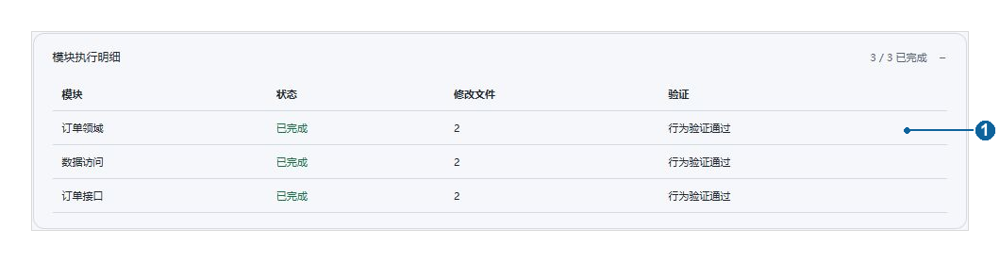

| 界面结果 | 应如何处理 |
| --- | --- |
| 行为验证通过 | 在本次验证范围内通过；继续核对报告与企业业务验收 |
| 声明模块 无可执行函数 | 该模块以类型或接口声明为主；检查其在集成中的使用 |
| 存在生产代码缺陷 | 查看失败证据，修复或重试相关模块，再做最终验收 |
| 验证环境不可用 | 修复 SDK、依赖或验证命令等环境问题后重验 |
| 行为结论未确定 | 检查证据、测试纠错与未解决项；不能作为行为通过 |
| 覆盖率无法确认 | 检查覆盖范围与缺失证据，按报告补充验证 |

带“（生成阶段）”的结果是中间结论；最终结论以联合验收及报告为准。只显示“编译通过”时，不能视为所有行为验收通过。

交付区的“覆盖率：未采集”不等于 0%，也不等于 100%。如企业要求覆盖率门槛，应另行采集并纳入企业 CI 与验收标准。测试全绿也不能自动消除尚未解决的行为证据问题。

<!-- page -->

## 16 常见问题与处理顺序

### 底部服务异常或一直准备中

先查看启动终端和“视图 → 输出 → RECAST”。确认 Docker 正常、本地模型准备完成，再检查模型端点、凭据和目标工具链。服务绿色只能说明依赖就绪，Key 是否有效仍以实际调用为准。

### 目标目录已登记 但索引未完成

目录登记和索引是两个步骤。打开导入任务，查看停在哪个阶段及第一条错误；检查路径可读性和服务状态，修复后重试导入。不要为重试删除 SeekDB 数据卷。

### 已经填了 Key 但还是文件视图

确认点击过“保存设置”，且使用当前平台与当前服务配置的凭据。查看模块建模是否失败或仍在队列中；按提示开始建模或重试建模与同步。填写 Key 本身不会证明已有仓库建模成功。

### 项目执行提示验证环境不可用

在运行扩展的同一平台检查 SDK、测试依赖及验收命令。Windows 中装过的 SDK 不代表 WSL 可用；反之亦然。确认实际命令可执行后，重试失败模块或继续原任务。

### 翻译超时或很久没有新日志

记录最后阶段与错误全文，区分模型调用、模块翻译、编译测试和服务准备超时。不同层有独立限制；Token 上限和服务首启等待预算不能延长所有阶段。先刷新状态，排查网络、额度及卡住的命令，再恢复任务。

### 刷新或重开后目标与后端不一致

先确认当前目标，再刷新状态并查看 RECAST 输出。后端仍忙时等待原任务结束或主动取消，再切换目标。界面收起不等于后端停止，避免同时重复创建任务。

向管理员提供：平台与版本、运行编号、工程名、失败阶段、错误全文、脱敏日志和已尝试操作。不要提供完整 Key 或含企业敏感代码的截图。

<!-- page -->

## 17 企业交接与管理员补充

### 每次交付前核对

- 目标项目、需求正文与参考版本正确，所需索引和建模完成。
- 项目执行已结束，所有模块结果及最终验收报告已检查。
- 独立输出工程可在企业环境重新构建；业务负责人确认关键场景。
- 归档需求、输出代码、验收报告、运行编号及提交记录。
- 未覆盖项、环境限制和待处理问题有明确记录，再进入企业发布流程。

### 编译和业务验收配置

管理员可在 VS Code 的用户设置中配置 `forexplore.backend.compileCommand`；有企业固定验收套件时，可配置 `forexplore.backend.verification`。命令、参数、超时与受保护测试文件必须匹配实际项目，不能把不存在的命令当作已通过验收。详细字段见扩展设置和仓库根目录 README。

### 单模块调试

研发人员可切到“单模块调试”，选中目标模块、输入局部需求并运行。该链路可能将结果应用回当前目标工程；操作前准备独立分支或可恢复检查点。它与整个项目的独立输出及断点任务不是同一个流程。

### 缓存与日常维护

模型缓存默认在当前用户目录下，可用 `FOREXPLORE_MODEL_CACHE` 调整；Windows 和 WSL 各自配置。管理员应保留索引数据、必要模型缓存和运行交付物。重试首启可复用已有缓存，不应以清空数据卷作为常规修复方法。

配套文件：本目录 Word 使用说明书、`images/` 截图、`examples/订单服务需求示例.md`。部署安装、企业模型源、外部 SeekDB 与双平台同步的完整配置见[仓库 README](../../README.md)。
