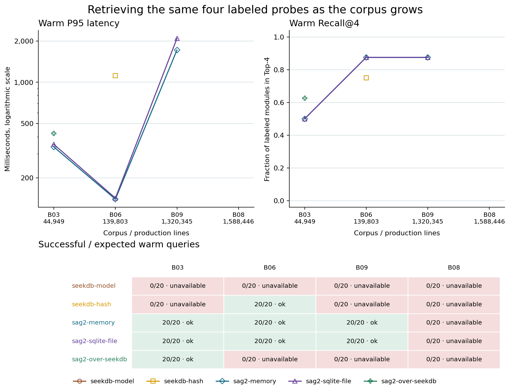

# RECAST 检索与开发速度实测

本轮覆盖 10 套场景、12 个模块查询、40 次独立项目交付。共 40 次通过固定行为验收并提交 Git。

在线 SAG2 两跳的检索 P50 为 631 ms，传统单跳为 1.19 ms。必需模块 Recall@4 从 87.5% 变为 100.0%。相对于传统单跳，配对总交付时间比为 0.95×（基线 / 两跳，超过 1 表示两跳更快）。

## 检索耗时

同一预建索引上串行轮换模式。每个查询各模式预热 1 次并剔除；生产单跳与本地结构裁决各测 25 次，在线裁决各测 5 次。单位为毫秒。百分位采用最近秩，汇总 12 个模块查询。local 使用 RECAST 自带 StructuralSag2JevJudge；在线 SAG2 包含到 OpenAI Decisions API 的网络往返。

| 模式 | 样本 | P50 ms | P95 ms | 平均裁决往返 ms |
|---|---|---|---|---|
| standard-1hop | 300 | 1.19 | 5.29 | — |
| local-sag2-1hop | 300 | 1.54 | 5.97 | — |
| local-sag2-2hop | 300 | 1.78 | 6.09 | — |
| sag2-1hop | 60 | 653.03 | 897.48 | 662.22 |
| sag2-2hop | 60 | 630.61 | 1371.52 | 740.20 |

## 检索质量

目标锚点由场景标注，Recall@4 为每个查询所需模块的命中比例，全部命中率要求所有必需模块同时进入前四；上下文实际装入前三份候选。诱饵剔除率表示 Top-4 无已标注诱饵的查询占比。

| 模式 | 锚点 Hit@1 | 锚点 Hit@4 | Recall@4 | 全部命中率 | 初始上下文覆盖 | 诱饵剔除率 |
|---|---|---|---|---|---|---|
| no-history-direct | — | — | — | — | 0.0% | — |
| standard-1hop | 91.7% | 100.0% | 87.5% | 75.0% | 87.5% | 25.0% |
| sag2-1hop | 83.3% | 100.0% | 87.5% | 75.0% | 87.5% | 25.0% |
| sag2-2hop | 75.0% | 100.0% | 100.0% | 100.0% | 100.0% | 25.0% |

三个指定桥接场景中，3/3 个协作者同时满足二跳首次发现和进入初始上下文。S01 的早停实测为 1/1。

## 开发速度

每个场景、每种模式各运行一次 GPT-6 Luna 工作 Agent，场景间最多四路并发。墙钟从流水线启动计至验收及独立 Git 提交，含快照、检索和上下文准备。均值按项目计算，补查与集成修复列为合计。一次通过要求该项目所有模块的第一次对应检查通过。

| 模式 | 交付 | 均时 s | 平均轮数 | 平均工具调用 | 首次编译 | 首次行为测试 | 补查 | 集成修复 |
|---|---|---|---|---|---|---|---|---|
| no-history-direct | 10/10 | 25.9 | 10.6 | 10.6 | 100.0% | 90.0% | 0 | 0 |
| standard-1hop | 10/10 | 23.8 | 9.9 | 9.9 | 100.0% | 100.0% | 3 | 0 |
| sag2-1hop | 10/10 | 24.7 | 10.0 | 10.0 | 100.0% | 100.0% | 4 | 0 |
| sag2-2hop | 10/10 | 25.1 | 9.8 | 9.8 | 100.0% | 100.0% | 2 | 0 |

同场景配对比率用基线总量除以两跳总量。胜场只计两跳数值严格更低的场景，平局从单侧精确符号检验剔除。时间检验与轮数检验分别列出。

| 对照 | 配对数 | 时间比 | 时间胜/非平 | 时间 p | 轮数比 | 轮数胜/非平 | 轮数 p |
|---|---|---|---|---|---|---|---|
| no-history-direct | 10 | 1.03 | 5/10 | 0.623 | 1.08 | 1/2 | 0.750 |
| standard-1hop | 10 | 0.95 | 1/10 | 0.999 | 1.01 | 1/1 | 0.500 |

任务板提出的开发提速假设未达到对两条基线均有显著改善的门槛。 两跳每项目平均 9.8 轮、25.1 秒；传统单跳为 9.9 轮、23.8 秒。固定行为契约足以独立实现这些小任务。

## 逐场景交付时间

单位为秒。各场景的工具次数、Token、编译次数、阶段耗时和配对压缩比见 velocity-summary.csv。

| 场景 | no-history-direct | standard-1hop | sag2-1hop | sag2-2hop |
|---|---|---|---|---|
| s01-singlehop-early-exit | 19.2 | 17.9 | 19.8 | 18.3 |
| s02-cjk-identifier-hybrid | 17.5 | 24.0 | 26.1 | 23.7 |
| s03-2hop-crypto-sealer | 26.4 | 20.2 | 25.5 | 21.7 |
| s04-attachment-quarantine-gate | 21.4 | 20.9 | 20.5 | 22.0 |
| s05-distractor-suppression | 20.3 | 19.7 | 20.2 | 20.3 |
| s06-structural-edge-bridge | 19.5 | 22.4 | 24.0 | 23.9 |
| s07-preview-pascal-bridge | 21.2 | 19.5 | 19.8 | 22.1 |
| s08-cross-repo-federation | 20.5 | 21.2 | 22.3 | 23.4 |
| s09-whole-project-pipeline | 56.4 | 52.6 | 48.4 | 54.7 |
| s10-scale-velocity-stress | 36.9 | 20.0 | 20.6 | 20.6 |

## 检索轨迹与下游返工

候选按优先级排列。前三份进入翻译上下文。S09 按三个模块分别列出候选和跳数。

| 场景 | 模式 | 前四候选 | 跳数 | 模型轮数 | 编译/测试 | 交付 s |
|---|---|---|---|---|---|---|
| S03 | sag2-2hop | display-1 → dispatch → ledger-seal → display-0 | 2 | 8 | 1/1 | 21.7 |
| S03 | standard-1hop | dispatch → display-1 → display-4 → display-3 | 1 | 9 | 1/1 | 20.2 |
| S06 | sag2-2hop | claim → display-2 → journal → display-1 | 2 | 8 | 1/1 | 23.9 |
| S06 | standard-1hop | claim → display-2 → display-3 → display-1 | 1 | 8 | 1/1 | 22.4 |
| S07 | sag2-2hop | display-1 → service → calibrator → display-0 | 2 | 8 | 1/1 | 22.1 |
| S07 | standard-1hop | service → display-1 → display-0 → display-3 | 1 | 8 | 1/1 | 19.5 |
| S08 | sag2-2hop | replay → delay → breaker → display-2 | 1 | 8 | 1/1 | 23.4 |
| S08 | standard-1hop | breaker → replay → delay → display-0 | 1 | 8 | 1/1 | 21.2 |
| S09 | sag2-2hop | intake → display-0 → display-1 → display-2 posting audit → posting | 1/1/1 | 24 | 3/3 | 54.7 |
| S09 | standard-1hop | intake → display-0 → display-1 → display-2 posting audit → posting | 1/1/1 | 24 | 3/3 | 52.6 |
| S10 | sag2-2hop | reservation → display-0 → display-6 → display-9 | 2 | 8 | 1/1 | 20.6 |
| S10 | standard-1hop | reservation → display-0 → display-6 → display-9 | 1 | 8 | 1/1 | 20.0 |

S03 标准单跳补查 1 次，使用 9 轮；两跳补查 0 次，使用 8 轮。两跳减单跳的交付时间差为 1.4 秒。两跳将展示类诱饵排至首位的场景为 S03、S07。S09 四组共触发 0 次项目集成修复。S10 四组按表中模式顺序分别执行 3 / 1 / 1 / 1 次模块行为测试。

## S10 规模与延迟

该资产库有 61 个模块、2889 条索引文档。

| 模式 | 样本 | P50 ms | P95 ms |
|---|---|---|---|
| standard-1hop | 25 | 3.84 | 4.44 |
| local-sag2-1hop | 25 | 5.97 | 6.79 |
| local-sag2-2hop | 25 | 6.03 | 7.02 |
| sag2-1hop | 5 | 763.54 | 897.48 |
| sag2-2hop | 5 | 708.69 | 907.04 |

S10 在线两跳 P95 超过任务板的 50 ms 门槛。S01 在线两跳的 0/5 次计时低于 5 ms。

## 复现条件与适用范围

RECAST 提交 `986d21575803fca473d39693042b04adb7d75c26`，Windows x64，AMD Ryzen 9 7940HX with Radeon Graphics        ，Node v26.0.0。场景使用随 benchmark 生成的 TS/Python 历史源码、固定模块提案、JS 目标骨架和独立验收脚本。项目分析、FTS5、检索、翻译工具、编译、验收与 Git 均通过 RECAST 运行。四组共享同一 feat 提交与相同源数据；standard 调用产品的 searchModules。历史索引构建在计时窗口外。

在线两跳的费用与延迟包含 JEV 裁决。no-history-direct 跳过历史检索，提交 direct-translator 标记。该版本 WorkspaceTranslationRuntime 对所有新任务均先调用 Analyzer，实测轮数含该阶段。每个项目平均工作 Agent 输入 Token 依模式顺序为 19772 / 31696 / 32044 / 31298；裁决输入 Token 为 0 / 0 / 2580 / 3869。Token 来自 API usage，包含缓存输入。固定行为协议对四组可见。一次开发运行无法估计同场景模型波动或覆盖生产需求分布，耗时代表本机和本次服务负载。

S06 预实验中，中英词面差异使三个检索模式都返回空候选，无法观测结构边。随后给历史锚点的业务说明补上查询中已有的中文职责，保持协作者和调用边原样，四组全部重跑。原始四条轨迹单独保存在 results/runs/s06-original，不计入汇总。

[OpenAI Decisions API 接口说明](https://developers.openai.com/api/reference/resources/decisions/methods/create)

<!-- recast-index-build -->

## Layer 0 · 建库速度、资源与规模上限

批次 `measured-build` 收录 47 次建库尝试。默认堆、零模型模块建模覆盖 45/45 个配置组合。包括扩堆或诊断尝试在内，128/188 个阶段成功，15 个阶段出错，45 个后续阶段受阻。所有尝试和已记录的部分计数都保存在 index-build-summary.csv 中。

### 按规模与语言划分的全量建库

表中按语言组成分组，每格显示默认堆全量建库秒数；ERR 表示该阶段失败。每个主矩阵组合各运行一次，时间比是本机单次配对观测。规模档沿用任务板分组，横向比较使用冻结快照的实际物理 LoC 和生产文件数。全量时间含扫描、结构化写入、检索投影、模块建模与摘要投影。初始化开销单列在 CSV 的 setupMs。

每个全量、增量、恢复和查询阶段的宿主预算为 300 秒。SeekDB 本身可提前返回 SQL 超时。E5 服务在测量前已加载，各配置共享该本地推理服务。结构化模块提案使用 directory-dependency/v1；变更比例基于生产文件数。增量间恢复源码和原分析哈希的时间不计入下一档。

B03 的 seekdb-hash 和 seekdb-model 首次运行收到 10 秒 SQL 超时。旧轨迹最后记录到模块投影，无法从日志确定报错的具体 SQL。随后驱动将观测性文档计数的失败单列为缺失指标，并保留原始失败行。

#### 单语言

| 语料 | 规模 | 语言 | 文件 | LoC | seekdb-model | seekdb-hash | sag2-memory | sag2-sqlite-file | sag2-over-seekdb |
|---|---|---|---|---|---|---|---|---|---|
| B01 | XS | TypeScript | 12 | 3308 | 12.95 | 2.12 | 0.92 | 0.77 | 12.09 |
| B02 | S | Java | 40 | 7191 | 26.71 | 3.33 | 1.11 | 0.90 | 26.89 |
| B04 | M | Python | 45 | 8717 | 27.31 | 2.70 | 1.16 | 1.02 | 27.46 |
| B06 | L | Java | 1309 | 139803 | ERR | 74.28 | 25.54 | 24.60 | ERR |
| B08 | XL | Java | 9929 | 1588446 | ERR | ERR | ERR | ERR | ERR |

#### 多语言

| 语料 | 规模 | 语言 | 文件 | LoC | seekdb-model | seekdb-hash | sag2-memory | sag2-sqlite-file | sag2-over-seekdb |
|---|---|---|---|---|---|---|---|---|---|
| B03 | S | Rust\|Go\|Java\|C#\|Python\|TypeScript\|ArkTS\|C++\|C\|Kotlin | 208 | 44949 | ERR | ERR | 12.53 | 11.83 | 194.78 |
| B05 | M | TypeScript\|Python | 153 | 33720 | 89.12 | 8.80 | 3.65 | 3.34 | 89.15 |
| B07 | L | C#\|JavaScript | 2019 | 218544 | ERR | 101.69 | 39.32 | 41.19 | ERR |
| B09 | XL | Java\|TypeScript\|JavaScript\|Python\|C# | 9784 | 1320345 | ERR | ERR | 227.84 | 262.17 | ERR |

同一语料与 seekdb-model 均完成全量建库时，计算基线耗时 / 当前耗时；超过 1 表示当前配置更快。表内取各语料比值的中位数，样本数显示该比较覆盖了多少个完整语料。

| 配置 | 成功配对 | 中位时间比 | 更快的语料数 |
|---|---|---|---|
| seekdb-hash | 4 | 9.07 | 4 |
| sag2-memory | 4 | 23.74 | 4 |
| sag2-sqlite-file | 4 | 26.72 | 4 |
| sag2-over-seekdb | 4 | 1.00 | 1 |

#### 巨仓堆上限

每个进程的采样 RSS 峰值以 MiB 计。失败阶段的耗时和内存只反映最后一次落盘采样，是下界；文件和文档累计量仅覆盖已完成的仓库。attemptElapsedMs 另含初始化、复制、恢复、查询和清理耗时。

| 语料 | 堆 MiB | 状态 | 已计时 s | RSS MiB | 失败原因 |
|---|---|---|---|---|---|
| B08 | 8192 | error | 284.40 | 5596.4 | Timeout 300 s in full/apache-camel-full/module-state/project-023593a239ffdce295213fac |
| B08 | default | error | 281.55 | 4045.1 | Timeout 300 s in full/apache-camel-full/module-state/project-02897aed8b5a27e5a6f98e84 |
| B09 | 8192 | ok | 225.95 | 3821.9 | — |
| B09 | default | ok | 227.84 | 2171.0 | — |

### Embedding、存储与增量开销

Embedding 调用和向量计数取自实际 provider.embed，HTTP 输入单独记录。下表汇总默认堆、全量成功的运行。峰值 RSS 为对应成功进程中的最大采样值。SQLite 的逻辑页和磁盘文件分开记录。各档恢复和增量生成的历史版本继续占用空间，因此阶段末文件大小包含保留的旧版本。SeekDB 将表统计或 SSTable 磁盘统计的来源保存在 seekdbMeasurement，memtable 内存单列。缺测保留为空。

| 配置 | 成功/全量尝试 | Embedding 调用 | 生成向量 | HTTP 输入 | 最大 RSS MiB | 可测 SeekDB 容量次数 |
|---|---|---|---|---|---|---|
| seekdb-model | 4/9 | 557 | 8415 | 8415 | 181.6 | 4/4 |
| seekdb-hash | 6/9 | 983 | 125239 | 0 | 405.6 | 6/6 |
| sag2-memory | 8/9 | 0 | 0 | 0 | 2171.0 | 0/8 |
| sag2-sqlite-file | 8/9 | 0 | 0 | 0 | 2553.7 | 0/8 |
| sag2-over-seekdb | 5/9 | 1189 | 17722 | 17722 | 220.4 | 5/5 |

每个增量阶段从相同原始源码状态出发。修改在可写副本进行，目标文件数为 1 或按比例向上取整。下表是同一尝试内增量/全量耗时比的中位数，括号中给出成功配对数；只重建有文件变动的仓。每个阶段的原始耗时、吞吐、解析 worker 峰值和存储占用可从 CSV 复算。

| 配置 | 1 文件 | 1% 文件 | 10% 文件 |
|---|---|---|---|
| seekdb-model | 0.29× (4) | 0.31× (4) | 0.31× (4) |
| seekdb-hash | 0.79× (6) | 0.67× (6) | 0.86× (6) |
| sag2-memory | 0.34× (8) | 0.43× (8) | 0.53× (8) |
| sag2-sqlite-file | 0.49× (8) | 0.56× (8) | 0.61× (8) |
| sag2-over-seekdb | 0.28× (5) | 0.30× (5) | 0.29× (5) |

本批固定结构建模路径为 directory-dependency/v1。本批没有单列 Agent 建模尝试。

### 建库后的规模–延迟–召回

每个可查询的完整索引另外加入同一个 23 模块探针仓。查询包含全部原生仓与探针仓，真值是 S01、S03、S06、S07 的标注模块。在这些曲线上，Recall@4 回答目标模块在不同背景资产池中的可找回程度。首次调用标记 cold；页缓存、模型与数据库保持运行。warm 是每模式每问题随后 5 次新查询，禁用宿主结果缓存。查询耗时和探针投影均不计入全量建库。

下表给出默认堆两跳结果。延迟单位为 ms。索引构建失败、超时或查询未运行时不赋予召回值。两种检索方式的逐题、首次及热查询样本数与百分位见 index-query-scale.csv。

| 语料 | LoC | 配置 | 首次 P50 / P95 | 热 P50 / P95 | 热 Recall@4 | 热成功/应测 |
|---|---|---|---|---|---|---|
| B03 | 44949 | seekdb-model | — / — | — / — | — | 0/20 |
| B03 | 44949 | seekdb-hash | — / — | — / — | — | 0/20 |
| B03 | 44949 | sag2-memory | 233.61 / 339.93 | 235.76 / 336.71 | 50.0% | 20/20 |
| B03 | 44949 | sag2-sqlite-file | 248.57 / 360.54 | 244.93 / 351.76 | 50.0% | 20/20 |
| B03 | 44949 | sag2-over-seekdb | 291.02 / 420.13 | 298.48 / 423.45 | 62.5% | 20/20 |
| B06 | 139803 | seekdb-model | — / — | — / — | — | 0/20 |
| B06 | 139803 | seekdb-hash | 950.32 / 1622.96 | 501.71 / 1115.16 | 75.0% | 20/20 |
| B06 | 139803 | sag2-memory | 107.75 / 144.64 | 105.25 / 139.83 | 87.5% | 20/20 |
| B06 | 139803 | sag2-sqlite-file | 105.39 / 143.55 | 107.04 / 142.39 | 87.5% | 20/20 |
| B06 | 139803 | sag2-over-seekdb | — / — | — / — | — | 0/20 |
| B08 | 1588446 | seekdb-model | — / — | — / — | — | 0/20 |
| B08 | 1588446 | seekdb-hash | — / — | — / — | — | 0/20 |
| B08 | 1588446 | sag2-memory | — / — | — / — | — | 0/20 |
| B08 | 1588446 | sag2-sqlite-file | — / — | — / — | — | 0/20 |
| B08 | 1588446 | sag2-over-seekdb | — / — | — / — | — | 0/20 |
| B09 | 1320345 | seekdb-model | — / — | — / — | — | 0/20 |
| B09 | 1320345 | seekdb-hash | — / — | — / — | — | 0/20 |
| B09 | 1320345 | sag2-memory | 1332.31 / 1698.42 | 1262.52 / 1721.62 | 87.5% | 20/20 |
| B09 | 1320345 | sag2-sqlite-file | 1481.16 / 2092.42 | 1493.52 / 2092.22 | 87.5% | 20/20 |
| B09 | 1320345 | sag2-over-seekdb | — / — | — / — | — | 0/20 |

在 sag2-memory 成功完成查询的最小和最大实测语料间，LoC 从 44949（B03）增至 1320345（B09）；两跳热 P95 从 336.71 变为 1721.62 ms，探针 Recall@4 从 50.0% 变为 87.5%。仓库数与语言构成也随语料变化。

### 未完成的尝试

同一尝试的失败只列一次；受阻的增量阶段仍在阶段分母和 CSV 中。查询错误在曲线 CSV 中单列。

| 语料 | 配置 | 堆 | 阶段 | 原因 |
|---|---|---|---|---|
| B03 | seekdb-model | default | full | Timeout, query has reached the maximum query timeout: 10000000(us), maybe you can adjust the session variable ob_query_timeout or query_timeout hint, and try again. |
| B03 | seekdb-hash | default | full | Timeout, query has reached the maximum query timeout: 10000000(us), maybe you can adjust the session variable ob_query_timeout or query_timeout hint, and try again. |
| B06 | seekdb-model | default | full | Timeout 300 s in full/flowable-engine/search-projection |
| B06 | sag2-over-seekdb | default | full | Timeout 300 s in full/flowable-engine/search-projection |
| B07 | seekdb-model | default | full | Timeout 300 s in full/nopcommerce/search-projection |
| B07 | sag2-over-seekdb | default | full | Timeout 300 s in full/nopcommerce/search-projection |
| B08 | seekdb-model | default | full | Timeout 300 s in full/apache-camel-full/search-projection |
| B08 | seekdb-hash | default | full | Timeout 300 s in full/apache-camel-full/search-projection |
| B08 | sag2-memory | 8192 | full | Timeout 300 s in full/apache-camel-full/module-state/project-023593a239ffdce295213fac |
| B08 | sag2-memory | default | full | Timeout 300 s in full/apache-camel-full/module-state/project-02897aed8b5a27e5a6f98e84 |
| B08 | sag2-sqlite-file | default | full | Timeout 300 s in full/apache-camel-full/search-projection |
| B08 | sag2-over-seekdb | default | full | Timeout 300 s in full/apache-camel-full/search-projection |
| B09 | seekdb-model | default | full | Timeout 300 s in full/apache-camel/search-projection |
| B09 | seekdb-hash | default | full | Timeout 300 s in full/flowable-engine/parse |
| B09 | sag2-over-seekdb | default | full | Timeout 300 s in full/apache-camel/search-projection |

### 驱动预实验

独立预实验批次 layer0 共 47 次尝试，47 次失败。其中 47 次在工作进程加载 CodeIntelligenceHost 时退出。逐次原始记录保存在 index-build/layer0/。本节上方的阶段统计与曲线使用批次 measured-build。

### B03 SQL 超时复核

单独批次 b03-count-diagnostic 使用相同语料和 300 秒预算，驱动将观测性计数失败单列。下表只用于排查首次运行的 SQL 超时，原始矩阵与曲线仍取首次尝试。文档数缺失表示观测查询未返回。

| 配置 | 全量结果 | 全量秒数 | 索引文档 | 已完成阶段 | 探针结果 | 错误 |
|---|---|---|---|---|---|---|
| seekdb-model | ok | 189.14 | 10637 | 4/4 | ok | — |
| seekdb-hash | ok | 26.59 | 10637 | 4/4 | ok | — |

### 巨仓长时限查询诊断

主矩阵在阶段预算内未取得完整查询数据的巨仓另行执行批次 `xl-query-diagnostic`。该批次仅执行全量建库与探针查询。下表给出每次独立尝试的堆配置、阶段预算、全量结果和错误。其耗时与查询结果单独列示，主矩阵分母和曲线沿用原始尝试。

| 语料 | 配置 | 堆 MiB | 阶段预算 s | 全量状态 | 全量 s | 建模工程数 | 索引文档 | 查询状态 | 错误 |
|---|---|---|---|---|---|---|---|---|---|
| B08 | sag2-memory | 8192 | 3600.00 | ok | 1403.78 | 699 | 506347 | ok | — |

cold 和 warm 采用主矩阵的四个探针及同一召回真值，每种检索方式分别应测 4 次和 20 次。P50、P95 和 Recall@4 仅汇总成功的查询。超时或建库失败会减少有效样本，失败及未运行数列在各自分母中。逐题明细见 index-query-scale-xl-diagnostic.csv。

| 语料 | 检索方式 | 阶段 | 成功/应测 | 查询失败 | 未运行 | P50 ms | P95 ms | Recall@4 |
|---|---|---|---|---|---|---|---|---|
| B08 | standard-1hop | cold | 4/4 | 0 | 0 | 291.19 | 330.30 | 62.5% |
| B08 | standard-1hop | warm | 20/20 | 0 | 0 | 279.36 | 325.30 | 62.5% |
| B08 | sag2-2hop | cold | 4/4 | 0 | 0 | 698.04 | 2726.72 | 100.0% |
| B08 | sag2-2hop | warm | 20/20 | 0 | 0 | 714.02 | 2605.77 | 100.0% |
